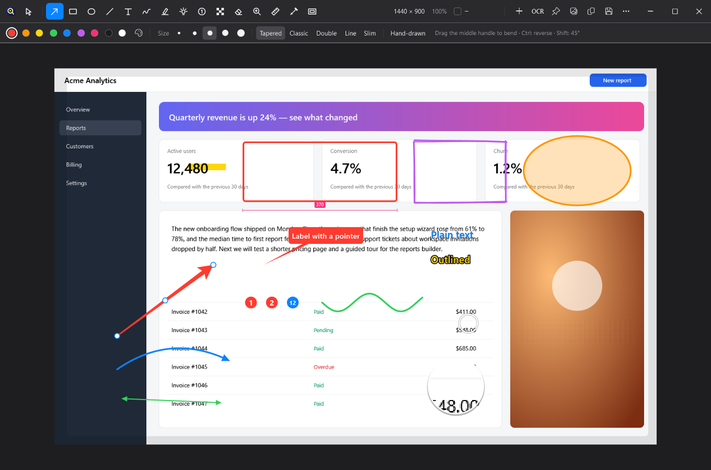
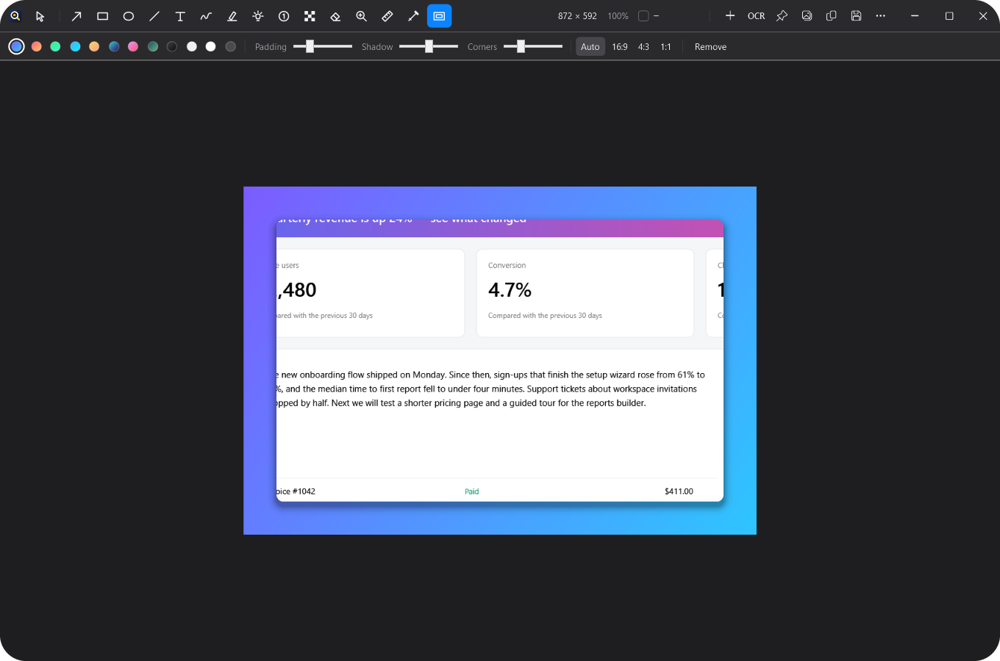
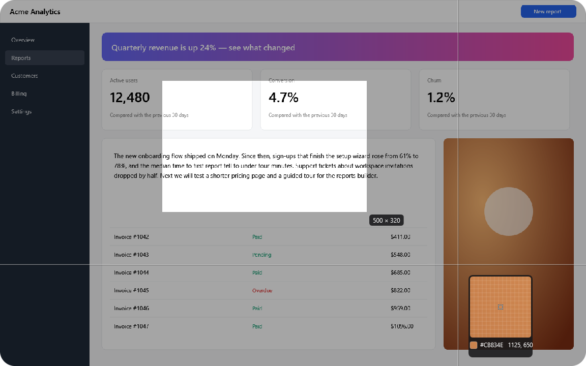
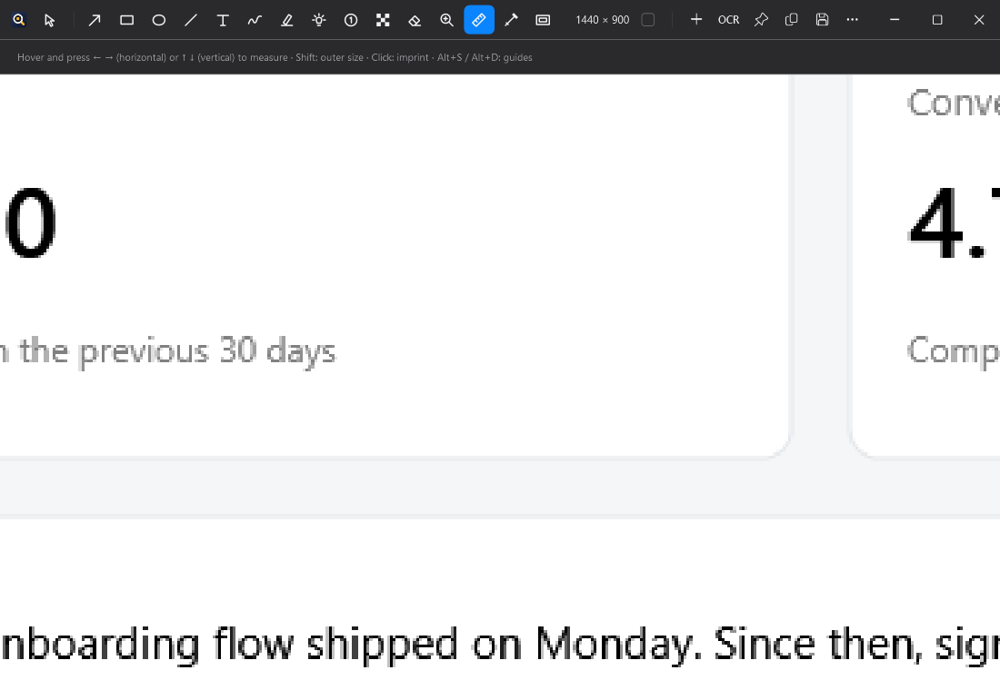
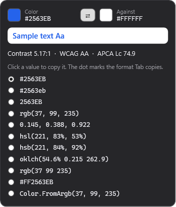

<p align="center">
  
</p>

<h1 align="center">Loupix</h1>

<p align="center">
  <strong>A fast, free screenshot tool for Windows.</strong><br>
  Capture, mark up, measure and share a screenshot in a couple of keystrokes.
</p>

<p align="center">
  <a href="https://github.com/farhang103/loupix/releases/latest"></a>
</p>

<p align="center">
  
  
  
</p>

<p align="center">
  
</p>

## What is Loupix?

Press a hotkey, drag over part of your screen, and your screenshot opens in a small editor. Draw an arrow, blur a password, measure a gap, grab a colour, then copy or save it and get back to work.

On my Mac I loved [Shottr](https://shottr.cc), a tiny screenshot app that makes all of this feel instant. I wanted the same workflow on Windows, so I built Loupix and made it free for everyone.

- **Free and open source.** No account, no ads, no trial, no paid tier.
- **Private.** Your screenshots stay on your PC. Loupix only goes online if you set up your own S3 upload.
- **Small and quick.** It sits in the notification area until you press a hotkey.

## Get started

1. **Download** the [latest release](https://github.com/farhang103/loupix/releases/latest):

   | Your PC | File |
   |---|---|
   | Most Windows PCs | `Loupix-win-x64.zip` |
   | Windows on Arm (for example Snapdragon laptops) | `Loupix-win-arm64.zip` |
   | You already have the [.NET 10 Desktop Runtime](https://dotnet.microsoft.com/download/dotnet/10.0) and want a tiny download | `Loupix-win-x64-requires-dotnet10.zip` |

2. **Unzip it and run `Loupix.exe`.** There is nothing to install. Windows may show a blue "Windows protected your PC" message because Loupix isn't code-signed yet: choose **More info**, then **Run anyway**.

3. **Take a screenshot.** Press `Ctrl+Shift+2` and drag over any area. The first launch also shows you the hotkeys and offers to start Loupix when you sign in.

Needs Windows 10 version 1809 or later, or Windows 11. Rounded window corners need Windows 11; on Windows 10 the main windows stay square.

## Everyday hotkeys

| Do this | Press |
|---|---|
| Capture an area (or click a window to capture just that window) | `Ctrl+Shift+2` |
| Capture the whole screen | `Ctrl+Shift+1` |
| Read text or a QR code from the screen | `Ctrl+Alt+Shift+O` |

You can add hotkeys for window, scrolling, repeat-area and delayed capture in **Settings > Hotkeys**. Screenshots are saved to your Downloads folder unless you choose another one.

## What it can do

**Capture**
- Full screen, any area, a single window, a repeat of the last area, or on a timer
- Scrolling capture for pages longer than your screen, handling sticky headers and footers
- Frozen-screen selection with a magnifier and a live size readout

**Mark up**
- Arrows in five bendable styles, boxes, ovals, lines, text labels with pointers, freehand and highlighter
- Numbered steps, a spotlight, a magnifier, and an optional hand-drawn look
- Pixelate, blur or erase, including a mode that hides only the text
- Pretty backgrounds with padding, shadow and rounded corners
- Combine several captures on one canvas, add image overlays, or make a before/after GIF

**Measure and pick colours**
- A pixel ruler that finds the edges under your cursor, plus guides
- A colour picker with HEX, RGB, HSL, HSB, OKLCH and more
- Contrast checks against WCAG and APCA

**Read and share**
- Copy text from any screenshot (OCR), and read QR codes
- Pin a screenshot on top of your other windows
- Copy, save, or drag it straight into another app
- Optional upload to your own S3-compatible storage, with the link copied for you

<table>
  <tr>
    <td width="50%"><br><sub>Backgrounds for sharing</sub></td>
    <td width="50%"><br><sub>Pixel-accurate area selection</sub></td>
  </tr>
  <tr>
    <td width="50%"><br><sub>Measure anything on screen</sub></td>
    <td width="50%"><br><sub>Colours and contrast</sub></td>
  </tr>
</table>

<details>
<summary><strong>All editor shortcuts</strong></summary>

| Keys | What it does |
|---|---|
| `V` `A` `R` `O` `L` `T` `D` `H` `S` `N` `P` `E` `M` `U` `I` `G` | Select/crop, arrow, rectangle, oval, line, text, freehand, highlighter, spotlight, step counter, pixelate/blur, erase, magnifier, ruler, colour picker, backdrop |
| Drag (select tool), then `Enter` | Crop to the selection |
| `A` / `Alt` held / click a selection edge | Auto-adjust the selection to the object (all edges / preview / one edge) |
| `Ctrl+click` | Select a flat-coloured object |
| `Delete` · `B` · `C` | Erase the selected area · blur it · copy its average colour |
| Arrows · `Shift+arrows` · `Ctrl+arrows` · `[` `]` | Nudge selection 1/10 px · resize · grow/shrink |
| `←` `→` / `↑` `↓` (nothing selected) | Ruler: measure horizontally / vertically between edges under the cursor; `Shift` = outer size; click to imprint |
| `Alt+S` / `Alt+D` (hold) | Vertical / horizontal guide; click to imprint |
| `Tab` · `Shift+Tab` | Copy the colour under the cursor · copy the text colour (darkest pixel nearby) |
| `Ctrl+1` · `Ctrl+0` · `Ctrl+2` · `Ctrl+=` / `Ctrl+-` | Fit · 100% · zoom to selection · zoom in/out |
| `Q` · `W` | Zoom on the selection's top-left / bottom-right corner |
| `Z`+click · `Z`+drag | Zoom in at a point · zoom to a rectangle |
| Right-drag · `Space`+drag · `Ctrl`+wheel | Pan · pan · zoom |
| `Shift` while drawing · `Space` while drawing · `Ctrl` while drawing an arrow | Constrain · move the object · reverse the arrow |
| `Alt`+drag an object · `Ctrl+D` · `Ctrl+C`/`Ctrl+V` | Duplicate · duplicate · copy/paste objects (pasting an image adds it as an overlay) |
| `1`–`9` | Spotlight darkness · overlay opacity · type a number to renumber a step counter |
| `Ctrl+Enter` · `Alt+↑`/`↓` | Cycle arrow style / freehand variability / highlighter caps · freehand smoothness |
| `Esc` | Copy and close (configurable: close, save, copy + save) |
| `Ctrl+C` · `Ctrl+S` · `Ctrl+Shift+S` | Copy (selection only if one exists) · save to the screenshots folder · save as |
| `Ctrl+P` · `Ctrl+T` · `Ctrl+E`/`F2` · `Ctrl+N` | Pin to screen · recognize text · upload (S3) · add another capture to the canvas |
| `Ctrl+Z` · `Ctrl+Shift+Z` | Undo · redo |
| `Ctrl+O` · `Ctrl+Shift+V` · `Ctrl+Shift+P` | Open file · open image from clipboard · print |

</details>

<details>
<summary><strong>Automate it with <code>loupix://</code> links</strong></summary>

Launchers, AutoHotkey or your own scripts can drive Loupix with links:

```
loupix://show                      loupix://grab/fullscreen          loupix://grab/area
loupix://grab/repeat               loupix://grab/window              loupix://grab/scrolling
loupix://grab/scrolling/reverse    loupix://grab/delayed             loupix://grab/delayed=10
loupix://grab/append               loupix://ocr                      loupix://load/clipboard
loupix://load/file                 loupix://settings
```

Every `grab/` link accepts `?then=copy,save,edit,pin,thumbnail`, for example `loupix://grab/area?then=save,pin`.

Because any app or web page could send these links, Loupix asks once before obeying them. You can change this in **Settings > General > Automation**. Running `Loupix.exe <image file>` opens that image in the editor.

</details>

## Build it yourself

You need the [.NET 10 SDK](https://dotnet.microsoft.com/download/dotnet/10.0) on Windows.

```powershell
dotnet build Loupix.sln -c Release
dotnet test Loupix.sln -c Release
dotnet publish src/Loupix/Loupix.csproj -c Release -r win-x64 --self-contained -p:PublishSingleFile=true -o out
```

| Folder | What's inside |
|---|---|
| `src/Loupix` | The WPF app: capture, overlay, editor, tray, hotkeys, settings |
| `src/Loupix.Core` | Shared types |
| `src/Loupix.Raster` | Pixel work: stitching, blur and pixelate, smart selection, ruler, resampling |
| `src/Loupix.Services` | OCR, QR, colour formats and contrast, S3 upload, GIF encoding |
| `tests/` | xUnit tests |
| `assets/logo/` | The logo, and the script that generates it |

## Contributing

Bug reports, ideas and pull requests are all welcome. Please [open an issue](https://github.com/farhang103/loupix/issues) first for anything large, and make sure `dotnet test` passes before sending a pull request.

## Credits

Loupix is an independent project inspired by [Shottr](https://shottr.cc) for macOS. It is not affiliated with or endorsed by Shottr or its developer, and it contains no Shottr code or artwork. If you're on a Mac, go and try Shottr.

Bundled third-party components are listed in [THIRD-PARTY-NOTICES.md](THIRD-PARTY-NOTICES.md).

## License

Copyright (C) 2026 Farhang Alizadeh.

Loupix is free software under the [GNU General Public License v3.0](LICENSE). You can use it, change it and share it for free. If you distribute a version of it, modified or not, it has to stay open source under the same license.
